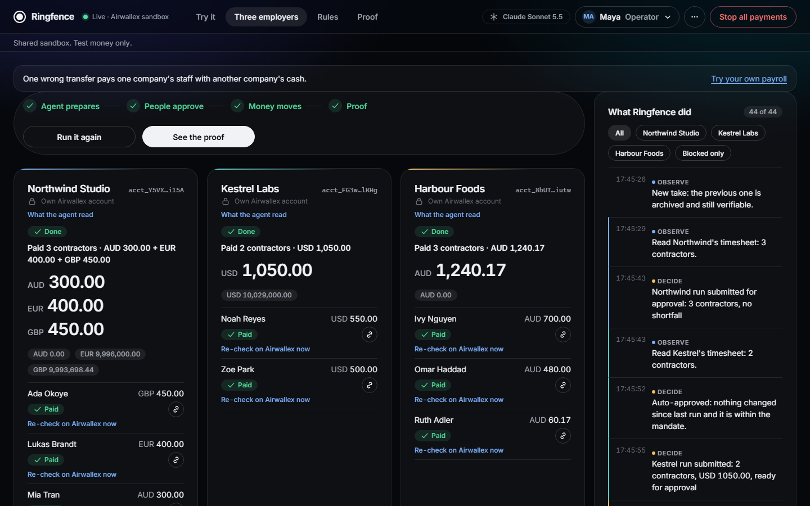

# Ringfence

**Multi-Employer Payroll Executor: deadline-aware, fund-isolated payroll runs on Airwallex.**
Airwallex Agentic Banking Hackathon, Kit 06.

A payroll provider pays contractors for several companies from one place. Ringfence lets an AI agent run every company's payroll on Airwallex. It never pays one company's people with another company's money. It never pays a bank account that nobody approved. Each company is told what it owes, and by when, in time to make payday.

- **Live demo** (no login, test money only): https://ringfence-hs23-eu.indiasouthcentral.cloudapp.azure.com
- **Main video, the product:** https://drive.google.com/file/d/12EMcRB7AoGwF9cdbaqS5QGDKp-xv-E7r/view?usp=sharing
- **Deep dive, the seven findings:** https://drive.google.com/file/d/1zJT3bRolDF0d6HG6CB4pQZLJZWVne-vB/view?usp=sharing



## The four parts of the brief

### 1. Multi-employer
Each employer is its own Airwallex account, with its own balances, payees, global accounts, approver and rules.
The rules are a **signed mandate** per employer. A mandate sets the allowed currencies, the allowed contractors, a cap per payment and a cap per run, whether FX is allowed and within what rate band, who approves, and when the mandate expires ([mandate.py](ringfence/mandate.py)).
One screen shows every employer's run side by side. Each run moves on its own: one can be paid while another waits for its approver and a third waits for money.

### 2. Fund-isolated
- **One login per employer, chosen by code.** Ringfence logs in to Airwallex *as* that employer (`x-login-as`), so the token can only see and move that employer's money. The model never chooses the account.
- **Airwallex enforces it too.** We tried 12 cross-account calls with one employer's token against another's account. All 12 returned `401`.
- **The release gate checks it again** before any money moves ([gate.py](ringfence/gate.py)). It checks that every line, the run, the token and the mandate belong to the same employer. It refuses a payee whose account is another employer's own account. It checks funds against this employer's balance only.
- **Balances are never pooled or summed.** FX sells only this employer's spare currency. Incoming money counts only if it lands in this employer's own account with the exact reference Ringfence issued ([funding.py](ringfence/funding.py)).

### 3. Deadline-aware
- Every run has a **pay date**. Each currency has a bank cut-off on that day (e.g. AUD 11:00 Sydney, GBP 12:00 London). Ringfence works back two hours from the cut-off to get an **act-by time**, shown in the employer's own timezone.
- When an employer is short, it gets a **funding card**: the exact amount, its own account details, a unique reference, and the act-by time. Example: *"Short AUD 1,240.17. Fund by Sat 09:00."*
- When a deposit with that reference covers the shortfall, the run **re-prices and carries on by itself**. A short deposit keeps the request open. A reversed deposit asks again for what is still missing.
- After release, every payout is tracked to **PAID**, including the transfers that Airwallex marks `OVERDUE`. A payout that bounces *after* PAID is caught as **RETURNED**. Sending it again needs a fresh approval.

### 4. Payroll runs
1. **Read.** The agent (Claude) reads timesheets and the inbox.
2. **Price.** Code prices every line in `Decimal`, adds fees, and quotes FX where it is needed.
3. **Approve.** A named person approves the exact batch: amounts, payees and *their bank details*.
4. **Release.** The gate re-checks everything, then each payment is created once.
5. **Track.** Each payment is followed through to PAID, and returns are handled. A per-payout fee is collected, and credited back if a payout returns.

Each payment's request ID is fixed before the first attempt. A timeout never triggers a second payment. Ringfence looks up the request ID instead and adopts the payment if it exists ([executor.py](ringfence/executor.py)).

## What is new

- **The agent proposes, code decides.** Claude reads documents and drafts the run. Amounts, caps, approvals, request IDs and which employer's login is used all come from code. Emails and invoices are untrusted. A bank change found in one is quarantined until someone confirms it by phone.
- **Approval covers the destination, not just the name.** The bank details are part of what the approver signs. If a payee's account changes on Airwallex after approval, the run is held, not paid.
- **Money waits for its own employer.** A short employer is never covered from another employer's balance. It gets its own instructions and deadline, and the run resumes when its money lands.
- **Tamper-evident record.** Every step goes into a hash-chained ledger. The ledger head is sent with each Airwallex transfer, so a rewritten ledger no longer matches Airwallex's copy. Run certificates verify offline.

## Try it

1. Open the live demo and go to **Three employers**. Press **Run Friday payroll**. Kestrel pays. Northwind waits for its approver. Harbour is short of AUD and gets its own funding card.
2. Approve Northwind. Fund Harbour, then approve it.
3. Use the **Try to break it** cards: a bank-change email, a double click, a network drop, a cross-employer call, a tampered ledger.
4. Open **Proof** for the per-employer isolation checks and certificates that verify offline.
5. Open **Try it**: upload a timesheet from [demo/samples/](demo/samples/), or type your own payroll.

Every row is badged **Live on Airwallex**, **Airwallex simulator** or **Simulated by us** (`[SIMULATED]`), so you can see which parts are real.

## Use it from Claude (MCP)

Ringfence ships an MCP server. It has no approve tool, so a person always signs.

```
claude mcp add ringfence -- uv run python -m ringfence.mcp_server --backend fake
```

If you open this repo in Claude Code, `.mcp.json` registers the server automatically. Its tools are `get_status`, `price_run`, `propose_run`, `request_release` and `certificate`. To use the live sandbox, pass `--backend live` and set the environment variables below.

## Run it locally

You need [uv](https://docs.astral.sh/uv/). The offline demo needs no keys: it uses a fake Airwallex and a scripted agent.

```
make sync
make fake-demo     # http://127.0.0.1:8000
make check         # lint + the offline test suite
```

**Live sandbox.** Set these environment variables, and never commit them: `AWX_CLIENT_ID`, `AWX_API_KEY`, `AWX_BASE_URL`, `AWX_PLATFORM_ACCOUNT` and `AWX_EMPLOYER_A/B/C`.
Then run `uv run python -m ringfence.setup_demo` and `make demo`. Set `ANTHROPIC_API_KEY` to use Claude. Without it, the scripted agent runs.

## How we tested it: seven findings

To test Ringfence, we built a reference agent the way Airwallex's docs, SDK and MCP suggest, then tried to make it pay the wrong person. Every finding below became a rule in Ringfence, and each was retested against the live app. [FINDINGS.md](FINDINGS.md) has the evidence: transfer IDs, probe outputs, and a script that reproduces them.

| # | Finding | Severity | Reference agent | Ringfence |
|---|---|---|---|---|
| F1 | Approval swap | High | paid ..9901 · 3/3 | bank details signed into the approval → HELD |
| F2 | Bank change from an email | High | paid ..9901 · 5/5 | quarantined until a phone callback |
| F5 | Batch payroll | Medium | booked ..9901 · can't cancel | no batches · bank details in each payment |
| F3 | SDK shares one login | High | A's payment on B's login | own login per client, set by code |
| F4 | Retry pays twice | Medium | GBP 2 moved for GBP 1 | request ID fixed before the first try → pays once |
| F6 | Payment list repeats | Low | 122 look unpaid → paid again | cursor paging → 222 of 222 |
| F7 | SDK retry drops its filter | Low | "it landed" → never paid | request_id matched on every item |
| ✓ | Airwallex isolation | Held | 12/12 cross-account calls blocked | built on it |

## Repo map

| Path | What |
|---|---|
| [ringfence/](ringfence/) | `gate.py` (release rules), `mandate.py` (signed per-employer rules), `funding.py` (shortfalls and deadlines), `fx.py`, `executor.py` (exactly-once payouts), `ledger.py` (hash chain), `agent/` (Claude loop), `app.py`, `mcp_server.py` |
| [static/](static/) | The single-page UI |
| [tests/](tests/) | The offline suite, run against a fake Airwallex |
| [FINDINGS.md](FINDINGS.md) | The seven findings, with evidence and fixes |
| [scripts/](scripts/) | `breakit.py` (reproduces the findings), isolation and money-path checks, sandbox probes |
| [bench/](bench/) | Probe outputs and benchmark results |
| [docs/](docs/) | [DEMO.md](docs/DEMO.md), [AIRWALLEX_GAPS.md](docs/AIRWALLEX_GAPS.md), [PROBES.md](docs/PROBES.md), [GAUNTLET.md](docs/GAUNTLET.md), [BENCH.md](docs/BENCH.md) |
| [deploy/](deploy/) | Azure VM, Caddy HTTPS, systemd |
| [video/](video/) | Source for the demo film (Remotion) |

## Honest notes

- This runs on the Airwallex sandbox only. Some steps are simulated because the sandbox can't do them: fee credits, employer top-ups, and payouts reaching PAID. These are all labelled `[SIMULATED]`. Every other Airwallex call in the live demo is real.
- Bank cut-off times are our own configured assumptions, not Airwallex data.
- The live demo is shared. Runs reset on request, and playground runs are deleted after 30 minutes.
- No secrets are in this repo.
