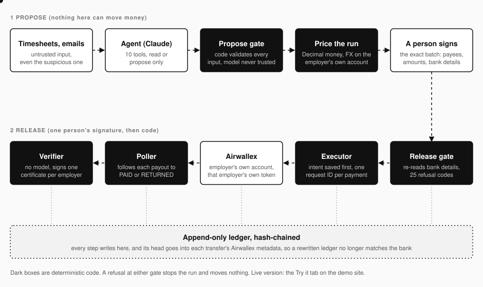

# Ringfence

[](https://ringfence-hs23-eu.indiasouthcentral.cloudapp.azure.com) [](https://www.airwallex.com/docs) [](https://www.anthropic.com/claude)  [](https://github.com/singhharsimar23-dotcom/ringefence/actions/workflows/check.yml) [](https://scorecard.dev/viewer/?uri=github.com/singhharsimar23-dotcom/ringefence)

**Multi-Employer Payroll Executor: deadline-aware, fund-isolated payroll runs on Airwallex.**
A control layer between AI agents and Airwallex payouts: the agent proposes, code checks, a person signs. Payroll is the first use.
Airwallex Agentic Banking Hackathon, Kit 06. Airwallex sandbox, with optional on-chain funding on the Metal testnet.

[Live demo](https://ringfence-hs23-eu.indiasouthcentral.cloudapp.azure.com) ..........
[Video 1: Security findings, the full walkthrough](https://drive.google.com/file/d/1zJT3bRolDF0d6HG6CB4pQZLJZWVne-vB/view?usp=sharing) ..........
[Video 2: Used on Claude MCP, the agent live](https://youtu.be/QnPQ9EYWWQQ) ..........
[Ringfence MCP](docs/MCP.md) ..........
[Findings report](FINDINGS.md) ..........
[Live run proof](docs/PROOF.md) ..........
[Documentation](docs/README.md)



## What it does

A payroll provider pays contractors for several employers. Payments can't be undone, each employer's money must stay separate, and every run has a pay-day deadline. An AI agent adds a new risk: it can be talked into paying the wrong account.

Ringfence runs each employer's payroll on that employer's own Airwallex account. Claude reads timesheets and emails and proposes the run. Deterministic code decides everything that moves money.

```
 timesheets, inbox ──► Claude (10 tools, none can move money)
                          │ proposals only
                  gate.check_propose ──► run priced in Decimal, FX quoted
                          │
                  named approver signs the exact batch (HMAC)
                          │
                  gate.check_release (pure function, 25 refusal codes)
                          │
     executor: INTENT saved ──► POST /transfers with this employer's token
                          │
     poller ──► PAID / RETURNED     verifier (no LLM) ──► signed certificate per employer
```

How each step is checked, with an animated diagram: [docs/ARCHITECTURE.md](docs/ARCHITECTURE.md).

## Security findings

We built a payroll agent the way Airwallex's docs, SDK and MCP suggest, then attacked it. It paid the wrong account or paid twice in five ways. Ringfence closes all five. Screenshots, transfer IDs and reproduce scripts are in **[FINDINGS.md](FINDINGS.md)**.

| # | Bug | Proven | Fix in Ringfence |
|---|---|---|---|
| [F1](FINDINGS.md#f1-approval-swap) | Payee bank account edited after approval; the approved payment goes to the new account | Live, 3/3 | Bank details pinned, re-checked before release, sent inline |
| [F2](FINDINGS.md#f2-bank-change-from-an-email) | Agent reads a fake invoice, changes the payee's bank account and pays it | Live, 5/5 | Bank changes held until a phone callback |
| [F3](FINDINGS.md#f3-the-node-sdk-shares-one-login) | Node SDK clients share one login, so one employer pays from another's account | SDK code | One token per employer, chosen by code |
| [F4](FINDINGS.md#f4-a-retry-pays-twice) | Retry after a lost response with a new request ID pays twice, with no cancel | Live | Request ID fixed before the first try; timeout means lookup, never resend |
| [F5](FINDINGS.md#f5-batch-payroll) | Batch pays the payee's account as it is at submit; the API can't cancel it | Live, 4/4 | No batches; bank details go in each transfer |

Airwallex's account isolation held: 12 of 12 cross-account calls were refused.

## Why it matters

Every company will want an agent running its payments. One question stops them: what if it sends the money to the wrong place?

We asked it on the live Airwallex sandbox. A standard agent, with a careful person approving every payment, paid a changed account 3 times out of 3. Ringfence held the run 3 times out of 3, before any money moved ([BENCH.md](docs/BENCH.md)).

| | Agent + a person approving every payment | Ringfence |
|---|---|---|
| The person's job | Check every payment | Sign once |
| A payee's bank account changes after approval | Paid the new account, 3/3 | Held the whole run, 3/3 |
| Connecting an agent | Integrate the API | One line |

The agent reads the files, prices the run, converts currency, checks every bank account, sends and verifies. The person signs. Behind that one signature: 476 tests, 500 random operation sequences, 36 injection documents, and 20 parallel releases with dropped responses that made exactly one transfer per line ([Testing](docs/TESTING.md)).

Payroll is where we proved it, because it is the hardest case: deadlines, several employers, money that can't be called back. The same controls fit any payout.

- **For Airwallex:** every run is payouts, FX and global-account deposits, from customers who needed this before they would let an agent near their money.
- **Revenue:** every landed payout is metered and charged through the gate, and a returned payout is credited ([fees.py](ringfence/fees.py)). Pricing is a policy on top of that meter: flat today, and tiered or percentage pricing with a floor and a cap, the model payments platforms like Stripe and Ramp run, applies to the same meter.

## Ways to use it

Ringfence serves a person and an agent with the same engine and the same approval.

| | Who | How | Start |
|---|---|---|---|
| **As an MCP server** | An AI agent: Claude Code or any MCP client that supports HTTP | The agent hands over the payroll files and gets back a priced, checked run. A person approves on a passkey page, and `release_payroll` sends exactly what was approved. | [docs/MCP.md](docs/MCP.md) |
| **In the browser** | A person: a payroll team or a reviewer | The [live site](https://ringfence-hs23-eu.indiasouthcentral.cloudapp.azure.com) shows three employers on their own Airwallex accounts, a flowchart of each run, a log of everything Ringfence did and a Proof tab. **Try it** runs your own files or a hostile document. | [Open the live demo](https://ringfence-hs23-eu.indiasouthcentral.cloudapp.azure.com) |
| **In your code** | An engineer | Embed the engine to price, approve, send and verify a run in about 15 lines, or read run state over HTTP. | [examples/embed.py](examples/embed.py), [docs/API.md](docs/API.md) |

Connect an agent in one line, with no login:

```
claude mcp add --transport http ringfence https://ringfence-hs23-eu.indiasouthcentral.cloudapp.azure.com/mcp
```

There is no approve tool and no tool takes bank details. Asked to skip the approval, the agent gets "Not approved" and the approval link. Bank accounts are re-read from Airwallex right before sending, and if one changed after approval the whole run is held. [Video 2: watch it used on Claude MCP](https://youtu.be/QnPQ9EYWWQQ).

## Run it

Needs [uv](https://docs.astral.sh/uv/). The offline demo uses a fake Airwallex and a scripted agent, so it needs no keys.

```
make sync
make fake-demo     # http://127.0.0.1:8000
make check         # lint + offline tests
```

Live sandbox, Claude as the agent, self-hosting the MCP server, and every setting: [docs/RUN_IT.md](docs/RUN_IT.md).

## Proof

- **A live run on Airwallex** (run `20261114-53jrfe`): 8 payouts in 4 currencies with FX, one short employer funded through its own global account, 3 platform fees and a signed certificate per employer. Every ID is in [docs/PROOF.md](docs/PROOF.md).
- **Alta (formerly Metal) on-chain funding:** a short employer signs a one-pull mandate for exactly its shortfall. Live testnet receipts include a repeat pull refused and a lookalike wallet refused. [docs/METAL.md](docs/METAL.md).
- **Real vs simulated:** transfers, FX, fees, beneficiaries and the isolation check are real sandbox calls. Payouts reaching `PAID`, a short employer's deposit and the platform's fee credit are [SIMULATED] and labelled. [docs/AIRWALLEX.md](docs/AIRWALLEX.md).

## Testing

- 476 offline tests against a fake Airwallex built from recorded sandbox behaviour, with a coverage floor of 85% (88% measured), plus 500 random operation sequences with money invariants checked after every step.
- The timesheet parser, which reads untrusted documents, is fuzzed with Atheris. Fuzzing found a stray carriage return that crashed intake instead of being rejected, now fixed and tested.
- 36 prompt-injection documents: an agent that obeys every instruction attempted 28 attacks and the gate blocked all 28. Claude followed none.
- Live on the sandbox, 20 parallel releases with 3 dropped responses made exactly one transfer per line.
- Supply chain: [OpenSSF Scorecard](https://scorecard.dev/viewer/?uri=github.com/singhharsimar23-dotcom/ringefence) 7.6 / 10 on 20 Nov 2026 (live badge at the top). Actions are pinned to commit SHAs, workflow tokens are read-only, CodeQL, Dependabot, dependency review and an OSV scan run, and `main` blocks force pushes and needs passing checks.

Details and how to run each: [docs/TESTING.md](docs/TESTING.md). Threats and what is left: [docs/THREAT_MODEL.md](docs/THREAT_MODEL.md).

## Limitations and path to production

- Sandbox and testnet only. Steps the sandbox can't perform are [SIMULATED]: fee credits, employer top-ups and payouts reaching `PAID`. The sandbox has no direct debit, so direct-debit reversals aren't exercised.
- The public MCP endpoint has no login. Each run is a throwaway sandbox world with one employer, and any caller can replace the last agent run.
- Bank cut-off times are configured assumptions, not Airwallex data.
- Wage and tax calculation stay in the employer's payroll system. This is not compliance software.
- Production needs: login on the MCP endpoint, a shared database in place of SQLite, connected accounts once the sandbox allows onboarding, and bank cut-off times from Airwallex data.

## Documentation

| | |
|---|---|
| [docs/ARCHITECTURE.md](docs/ARCHITECTURE.md) | the flow, components, life of a run, trust boundaries, mechanisms with code links |
| [docs/MCP.md](docs/MCP.md) | connect an agent: tools, approval, errors |
| [docs/RUN_IT.md](docs/RUN_IT.md) | offline demo, live sandbox, settings, self-hosting |
| [docs/AIRWALLEX.md](docs/AIRWALLEX.md) | what it calls, real vs simulated, the Airwallex docs it relies on |
| [docs/THREAT_MODEL.md](docs/THREAT_MODEL.md) | attacks, controls, what is left |
| [docs/DECISIONS.md](docs/DECISIONS.md) | why it is built this way |
| [FINDINGS.md](FINDINGS.md) | the five security findings with evidence |
| [docs/README.md](docs/README.md) | the full index |

[Contributing](CONTRIBUTING.md) · [Changelog](CHANGELOG.md) · [Roadmap](ROADMAP.md) · [Security policy](SECURITY.md) · [License](LICENSE)
