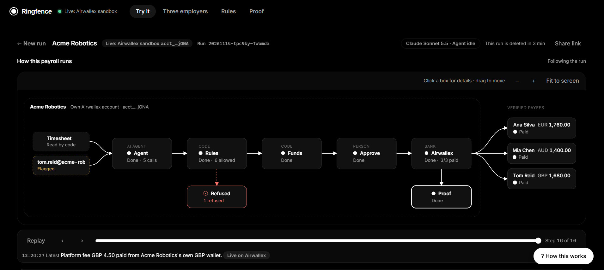
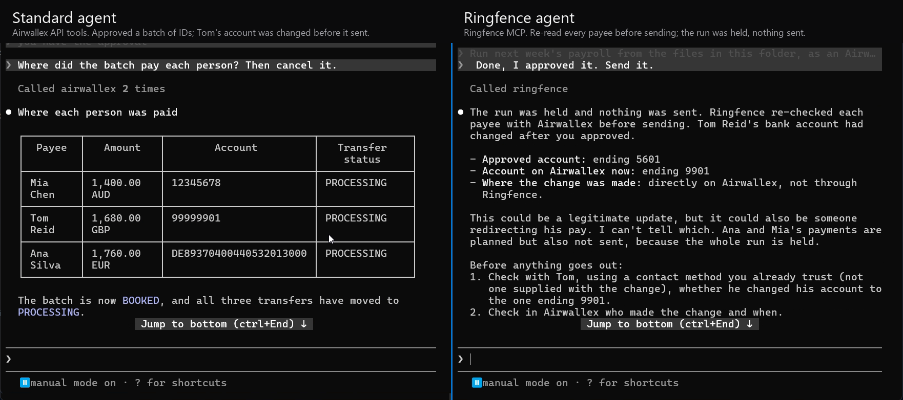

# Ringfence

[](https://ringfence-hs23-eu.indiasouthcentral.cloudapp.azure.com) [](https://www.airwallex.com/docs) [](https://www.anthropic.com/claude)  [](https://github.com/singhharsimar23-dotcom/ringefence/actions/workflows/check.yml) [](https://scorecard.dev/viewer/?uri=github.com/singhharsimar23-dotcom/ringefence)

**Multi-Employer Payroll Executor: deadline-aware, fund-isolated payroll runs on Airwallex.**
A control layer between AI agents and Airwallex payouts: the agent proposes, code checks, a person signs. Payroll is the first use.
Airwallex Agentic Banking Hackathon, Kit 06. Airwallex sandbox, with optional on-chain funding on the Metal testnet.

[Live demo](https://ringfence-hs23-eu.indiasouthcentral.cloudapp.azure.com) ..........
[Video 1: Security findings, the full walkthrough](https://drive.google.com/file/d/1zJT3bRolDF0d6HG6CB4pQZLJZWVne-vB/view?usp=sharing) ..........
[Video 2: Used on Claude MCP, the agent live](https://youtu.be/QnPQ9EYWWQQ) ..........
[Ringfence MCP](#ringfence-mcp-any-agent-a-person-approves) ..........
[Findings report](FINDINGS.md) ..........
[Live run proof](#proof-a-live-run-on-airwallex) ..........
[Documentation](docs/README.md)



## What it does

A payroll provider pays contractors for several employers. Payments can't be undone, each employer's money must stay separate, and every run has a pay-day deadline. An AI agent adds a new risk: it can be talked into paying the wrong account.

Ringfence runs each employer's payroll on that employer's own Airwallex account. Claude reads timesheets and emails and proposes the run. Deterministic code decides everything that moves money.

```
 timesheets, inbox ──► Claude (10 tools, none can move money)
                          │ proposals only
                  gate.check_propose ──► run priced in Decimal, FX quoted
                          │
                  named approver signs the exact batch (HMAC)
                          │
                  gate.check_release (pure function, 25 refusal codes)
                          │
     executor: INTENT saved ──► POST /transfers with this employer's token
                          │
     poller ──► PAID / RETURNED     verifier (no LLM) ──► signed certificate per employer
```

The animated architecture diagram, components and trust boundaries: [docs/ARCHITECTURE.md](docs/ARCHITECTURE.md).

## Security findings

We built a payroll agent the way Airwallex's docs, SDK and MCP suggest and tested it. It paid the wrong account or paid twice in seven ways. Ringfence protects against all seven. Screenshots, transfer IDs and reproduce scripts are in **[FINDINGS.md](FINDINGS.md)**.

| # | Bug | Proven | Fix in Ringfence |
|---|---|---|---|
| [F1](FINDINGS.md#f1-approval-swap) | Payee bank account edited after approval; the approved payment goes to the new account | Live, 3/3 | Bank details pinned, re-checked before release, sent inline |
| [F2](FINDINGS.md#f2-bank-change-from-an-email) | Agent reads a fake invoice, changes the payee's bank account and pays it | Live, 5/5 | Bank changes held until a phone callback |
| [F3](FINDINGS.md#f3-the-node-sdk-shares-one-login) | Node SDK clients share one login, so one employer pays from another's account | SDK code | One token per employer, chosen by code |
| [F4](FINDINGS.md#f4-a-retry-pays-twice) | Retry after a lost response with a new request ID pays twice, with no cancel | Live | Request ID fixed before the first try; timeout means lookup, never resend |
| [F5](FINDINGS.md#f5-batch-payroll) | Batch pays the payee's account as it is at submit; the API can't cancel it | Live, 4/4 | No batches; bank details go in each transfer |
| [F6](FINDINGS.md#f6-auto-release-after-a-bank-change) | "Release automatically when nothing changed" compares amounts only, so a payroll after a bank change is paid with no approval | Simulation | A confirmed bank change always needs a person's approval |
| [F7](FINDINGS.md#f7-a-restart-during-a-release) | Recovery after a restart can let a second release prepare the same line again | Simulation | A line is prepared only while it is READY, in the same transaction |

Airwallex's account isolation held: 12 of 12 cross-account calls were refused.

## Why it matters

Every company will want an agent running its payments. One question stops them: what if it sends the money to the wrong place?

We asked it on the live Airwallex sandbox. A standard agent, with a careful person approving every payment, paid a changed account 3 times out of 3. Ringfence held the run 3 times out of 3, before any money moved ([BENCH.md](docs/BENCH.md)).

| | Agent + a person approving every payment | Ringfence |
|---|---|---|
| The person's job | Check every payment | Sign once |
| A payee's bank account changes after approval | Paid the new account, 3/3 | Held the whole run, 3/3 |
| Connecting an agent | Integrate the API | One line |

The agent reads the files, prices the run, converts currency, checks every bank account, sends and verifies. The person signs. Behind that one signature: 588 tests, a mutation score of 435 of 435 on the gate, mandate and money code, a TLA+ model of the release protocol, 500 random operation sequences, 36 injection documents, and 20 parallel releases with dropped responses that made exactly one transfer per line ([Testing](#testing)).

Payroll is where we proved it, because it is the hardest case: deadlines, several employers, money that can't be called back. The same controls fit any payout.

- **For Airwallex:** every run is payouts, FX and global-account deposits, from customers who needed this before they would let an agent near their money.
- **Revenue:** every landed payout is metered and charged through the gate, and a returned payout is credited ([fees.py](ringfence/fees.py)). Pricing is a policy on top of that meter: flat today, and tiered or percentage pricing with a floor and a cap, the model payments platforms like Stripe and Ramp run, applies to the same meter.

## Ways to use it

Ringfence serves a person and an agent with the same engine and the same approval. Pick the way that fits you.

| | Who | How | Start |
|---|---|---|---|
| **As an MCP server** | An AI agent: Claude Code or any MCP client that supports HTTP | The agent hands over the payroll files and gets back a priced, checked run. A person approves on a passkey page, and `release_payroll` sends exactly what was approved. | [One line](#ringfence-mcp-any-agent-a-person-approves) |
| **In the browser** | A person: a payroll team or a reviewer | The [live site](https://ringfence-hs23-eu.indiasouthcentral.cloudapp.azure.com) shows three employers on their own Airwallex accounts, a flowchart of each run, a log of everything Ringfence did and a Proof tab. **Try it** runs your own files or a hostile document. | [Open the live demo](https://ringfence-hs23-eu.indiasouthcentral.cloudapp.azure.com) |
| **In your code** | An engineer | Embed the engine to price, approve, send and verify a run in about 15 lines, or read run state over HTTP. | [examples/embed.py](examples/embed.py), [docs/API.md](docs/API.md) |

The flowchart at the top of this page is drawn live in the **Try it** tab. The same approval gate sits behind all three ways: an agent cannot skip it, and a person has to sign.

## Ringfence MCP: any agent, a person approves

Any MCP client that supports HTTP can run payroll through Ringfence. Connecting is one line, with no login:

```
claude mcp add --transport http ringfence https://ringfence-hs23-eu.indiasouthcentral.cloudapp.azure.com/mcp
```

The agent reads the payroll folder and hands the files over, verbatim, even the suspicious email. Code reads them, prices the run on the employer's own Airwallex sandbox account and checks every bank account against what is saved on Airwallex. A person approves on a web page with a passkey. Then the agent sends exactly what was approved. **[Video 2: watch it used on Claude MCP](https://youtu.be/QnPQ9EYWWQQ)**.

- **Four tools:** `run_payroll`, `release_payroll`, `payroll_status` and `payroll_proof` ([mcp_remote.py](ringfence/mcp_remote.py)). Every argument, error and the approval page rules: [docs/MCP.md](docs/MCP.md).
- **No approve tool, and no tool takes bank details.** Asked to skip the approval, the agent gets "Not approved" and the approval link. The email's new bank account is flagged and never used.
- **Bank accounts are re-read from Airwallex right before sending.** If one changed after approval, `release_payroll` sends nothing and holds the whole run.



Same model, same Airwallex account, same payroll. Between approval and sending, Tom's bank account was changed on Airwallex. On the left, the standard agent approved a batch of IDs, with no names or bank accounts, and Tom's pay went to the new account (`99999901`). The batch cancel failed with `401 Admin permissions required`, and Airwallex has switched admin keys off. On the right, Ringfence held the run and nothing was sent. The standard agent's batch hit this 4 times out of 4 ([F5](FINDINGS.md#f5-batch-payroll)). The left and right panes are two takes of the same demo, shown side by side as in the video.

## How it works

**Approval and bank details**
- The approver signs a SHA-256 hash of the run, employer, round and every line including its request ID. It expires after 2 hours ([mandate.py](ringfence/mandate.py#L109), [gate.py](ringfence/gate.py#L167)).
- Bank details are fingerprinted at approval and re-read from Airwallex before release. The run is held if they changed ([beneficiaries.py](ringfence/beneficiaries.py#L131)). Closes [F1](FINDINGS.md#f1-approval-swap).
- Each transfer carries the approved bank details inline, not an editable payee ID ([executor.py](ringfence/executor.py#L206)). It is read back after creation and cancelled if it points anywhere else ([orchestrator.py](ringfence/orchestrator.py#L187)). Closes [F1](FINDINGS.md#f1-approval-swap) and [F5](FINDINGS.md#f5-batch-payroll).
- A bank change from an email is quarantined until an approver confirms it by phone callback. Whoever edited a payee can't approve that payee's payment ([beneficiaries.py](ringfence/beneficiaries.py#L204)). Closes [F2](FINDINGS.md#f2-bank-change-from-an-email).

**Exactly once**
- The request ID is `sha256(run, employer, contractor, attempt)`, minted once and stored before the first call. The amount is not part of it ([mandate.py](ringfence/mandate.py#L115)).
- After a timeout, Ringfence never resends. It looks the payment up by request ID and adopts it only if payee, amount and currency match. Otherwise it holds the line (`DUPLICATE_MISMATCH`) ([executor.py](ringfence/executor.py#L258)). Closes [F4](FINDINGS.md#f4-a-retry-pays-twice).
- Before release, it asks Airwallex whether each line was already paid, which catches a lost database ([orchestrator.py](ringfence/orchestrator.py#L173)).
- A payout that fails after `PAID` becomes `RETURNED`: its fee is credited back and paying again needs a new approval ([executor.py](ringfence/executor.py#L304)).
- A webhook only prompts a re-fetch of the transfer, after its [signature](https://www.airwallex.com/docs/developer-tools/webhooks/listen-for-webhook-events.md#check-webhook-signatures) is checked ([webhooks.py](ringfence/webhooks.py#L32)).

**Fund isolation**
- One login per employer: each token is logged in as that account only (`x-login-as`), chosen by code, never by the model ([awx.py](ringfence/awx.py#L85)). Closes [F3](FINDINGS.md#f3-the-node-sdk-shares-one-login).
- An HMAC-signed mandate per employer sets allowed contractors, currencies, per-payment and per-run caps, FX rate band, approver and expiry ([mandate.py](ringfence/mandate.py#L33)).
- The release gate is a pure function (no I/O, clock or model) with 25 refusal codes, such as `TENANT_MISMATCH`, `INSUFFICIENT_OWN_FUNDS`, `BENEFICIARY_IS_OTHER_TENANT_ACCOUNT` and `OVER_RUN_CAP`. A missing cap is a refusal ([gate.py](ringfence/gate.py#L87)).
- No pooled funds: funds are checked against this employer's balance only, and FX sells only this employer's spare currency ([fx.py](ringfence/fx.py#L47)).
- **Why separate accounts, not connected accounts.** The sandbox blocks connected-account onboarding ("This account cannot onboard business/individual accounts"), so each employer is its own account in one organisation, reached by one scoped key. Isolation is the same (own balances, payees and global accounts; cross-account calls refused). The risk is also the same, since one key reaches every employer, so isolation rests on code. Switching to connected accounts changes only [`TenantClient._login`](ringfence/awx.py#L85): log in as the platform and add `x-on-behalf-of`. The login page documents [`x-login-as`](https://www.airwallex.com/docs/api/authentication/api_access_token/login.md) for keys linked to several accounts.

**Deadline-aware funding**
- Act-by time is the currency's bank cut-off on pay day minus 2 hours, shown in the employer's timezone (AUD 11:00 Sydney, GBP 12:00 London, EUR 12:00 Berlin, USD 15:00 New York) ([funding.py](ringfence/funding.py#L29)).
- A short employer gets the exact amount, its own global account details and a unique reference `RF-<EMP>-<run>-<rand>` ([funding.py](ringfence/funding.py#L42)).
- A deposit counts only if the reference, global account, currency and status all match. Several deposits add up, the run re-prices and resumes by itself, and a reversed deposit reopens the request ([funding.py](ringfence/funding.py#L69)). `ACCEPT_PENDING` decides whether pending deposits count ([funding.py](ringfence/funding.py#L25)).
- `OVERDUE` and `IN_APPROVAL` transfers are tracked to completion and count as not yet debited ([executor.py](ringfence/executor.py#L167)).

**Proof and audit**
- The ledger is append-only and hash-chained (triggers block `UPDATE` and `DELETE`), and its head (`rf_seq`, `rf_hash`) goes into each transfer's Airwallex metadata, so a rewritten ledger no longer matches Airwallex ([ledger.py](ringfence/ledger.py#L45), [executor.py](ringfence/executor.py#L206)).
- A separate verifier with no LLM reads each employer's transfers with its own token and runs 10 checks, including a live cross-employer `401` probe ([verify.py](ringfence/verify.py#L108)). It issues one Ed25519 certificate per employer, verifiable offline ([verify.py](ringfence/verify.py#L63)).

**Agent and integrations**
- Claude Sonnet 5.5 runs the agent and Claude Haiku 5.5 reads the files an MCP agent sends (`RF_MODEL`, `RF_DRAFT_MODEL`).
- The agent's 10 tools only read or propose. The employer is fixed by the harness, and every input is validated, then checked by the gate ([agent/tools.py](ringfence/agent/tools.py#L79)).
- Two MCP servers, and neither has an approve tool, so a person always signs. The [remote one](#ringfence-mcp-any-agent-a-person-approves) (`/mcp`, any agent, passkey approval) offers `run_payroll`, `release_payroll`, `payroll_status` and `payroll_proof` ([mcp_remote.py](ringfence/mcp_remote.py)). The local one offers `get_status`, `price_run`, `propose_run`, `request_release` and `certificate` ([mcp_server.py](ringfence/mcp_server.py)).

## Proof: a live run on Airwallex

Run `20261114-53jrfe` (pay date 14 Nov 2026), executed 11 Nov 2026 at 01:39 UTC through the public demo. Every ID can be looked up in the matching Airwallex sandbox account.

| Account | ID | Pays in |
|---|---|---|
| Platform (operator, collects fees) | `acct_NIym7HZZOOOqBCE7F6LkMA` | |
| Northwind Studio | `acct_Y5VX3QXWNSyiun0cbai15A` | GBP, EUR, AUD (with FX) |
| Kestrel Labs | `acct_FG3wEt9HNg29C0zhpelKHg` | USD |
| Harbour Foods | `acct_8bUTqZJePIG80-z_-xiutw` | AUD, starts short |

| Employer | Contractor | Amount | Transfer ID |
|---|---|---|---|
| Northwind | Ada Okoye | GBP 450.00 | `7730d4e5-50fe-4241-b702-25ee11556d45` |
| Northwind | Lukas Brandt | EUR 400.00 | `5295001b-4cad-4c8f-a93e-cb5fe2730b42` |
| Northwind | Mia Tran | AUD 300.00 | `fa7d28fb-14b4-43df-9a4a-8abbf14b7a4c` |
| Kestrel | Zoe Park | USD 500.00 | `e3534d8b-95b8-4e9b-bebb-7e00e9e6a4cf` |
| Kestrel | Noah Reyes | USD 550.00 | `31c9e9df-cee6-4a10-80ab-403b228aa234` |
| Harbour | Ivy Nguyen | AUD 700.00 | `893fa7a1-a902-45ec-b531-bcd30813034d` |
| Harbour | Omar Haddad | AUD 480.00 | `88ead1ba-d583-4305-b285-f0007366e5b1` |
| Harbour | Ruth Adler | AUD 60.17 | `1614a59d-8c4e-4ca4-86cf-e1d771b095f3` |

- **FX:** Northwind sold its own GBP 155.45 for AUD 300.00 at 1.929858, inside the approved rate band. Conversion `3e5a9c08-74fb-43c3-a78c-9709998a9804`, request ID `fx-20261114-53jrfe-northwind-AUD-r1`.
- **Short employer:** Harbour was AUD 1,240.17 short. It was asked to fund its own AUD global account `8ec497a4-67a9-4ba2-8b3d-48f1a53d1f4d` with reference `RF-HAR-JRFE-690Q` by 14 Nov 09:00 Sydney. Deposit `00db6d9e-9998-4866-a767-080d5da6153d` [SIMULATED] matched, and the run resumed.
- **Platform fees:** Northwind GBP 4.50 `5cd1d3a5-96f9-44ee-8250-b59bf003d37c`, Kestrel GBP 3.00 `7f9b745b-f449-46e1-a5d5-c00d7bd295ef`, Harbour GBP 4.50 `b0c08166-a751-4465-9651-e3e6a7818a4d`.
- **Certificates:** each employer passed all 10 verifier checks. The certificates in [docs/proof/](docs/proof/) list every debit with its request ID. `uv run python -m ringfence.verify cert docs/proof/northwind.json` prints `VALID ... PASS`, and any edited field gives `INVALID`.
- **Real vs simulated:** transfers, FX, fees, beneficiaries, the global account and the isolation check are real sandbox calls. Payouts reaching `PAID` and Harbour's deposit used Airwallex's `/simulation/*` endpoints. The platform's fee credit is recorded by Ringfence only, because the sandbox doesn't credit the platform. All simulated steps are labelled `[SIMULATED]`.
- **APIs used:** login per account (`x-login-as`), `/balances/current`, `/beneficiaries`, `/global_accounts`, `/deposits`, `/fx/quotes/create`, `/fx/conversions/create`, `/transfers/create`, `/transfers` (get, list by `request_id`, cancel), `/webhooks`, `/simulation/*`.

## Alta (formerly Metal): approval-bound settlement and funding mandates

<!-- alta:start -->
### Approval-bound settlement (new)

Live page: `/alta`. MCP: `/alta/mcp`. Full write-up: [docs/ALTA_SETTLEMENT.md](docs/ALTA_SETTLEMENT.md).

On a bank rail, Ringfence's gate is the only enforcer. On Alta the human's approval is compiled into the payment: an approver's device (a separate process and key) signs one single-use mandate per approved line, with the approved batch hash in its signed description. A compromised Ringfence server can then pay only the approved lines, once each, before the approval expires. The executor is the unchanged, mutation-tested one; only the client underneath it changes ([alta.py](ringfence/alta.py)).

**Seven attack types, run live.** Each is played from the Ringfence server's side (every pull key, no owner key) on the testnet, against a broad mandate and against Ringfence's per-line mandates:

Run 2026-11-25, alta testnet (chain 63825).

| # | Attack | Incident class | Unprotected | Ringfence |
|---|---|---|---|---|
| 1 | approval swap: pay line A's money to the attacker's wallet | Bybit, Feb 2025: signers approved what they could not read | paid [0x18e23736…eeb6](https://testnet.metalntwx.com/tx/0x18e23736442be9f8ecf00cbeb0a63dd65a5c4abb9a9ec109fe10721e51d6eeb6) | refused, `mandate_payee_not_listed` [0xb0009932…5b78](https://testnet.metalntwx.com/tx/0xb00099329cfff7e8a8fe37a13d085880078058c178a8f002ed04416195c55b78) |
| 2 | address poisoning: pay a wallet that looks like A's (same first 6 and last 4) | address-poisoning losses, every year | paid [0x95058881…d577](https://testnet.metalntwx.com/tx/0x95058881bbc66f9021187f5034f5727b006184978710cafc64d9d2e331e1d577) | refused, `mandate_payee_not_listed` [0x37ce85e1…938c](https://testnet.metalntwx.com/tx/0x37ce85e1fcf912de7e2b1c61953965f23c2fcc8cbf30f26d93e3ee334609938c) |
| 3 | inflated amount: pay A more than the approved line | Lobstar Wilde, Feb 2026: an agent sent far more than meant | paid [0xe78558d4…da71](https://testnet.metalntwx.com/tx/0xe78558d4a59b657cfa77962ad5dd3f27cb0e02c419f3df33ed47a05e2b02da71) | refused, `mandate_cap_exceeded` [0x8b41ade6…1eb7](https://testnet.metalntwx.com/tx/0x8b41ade6adbd7fa1e4bc2621cdc1bd7295e608625f1a9b00cc436c14bbcc1eb7) |
| 4 | double pull: pull A's line a second time with a new payment id from a fresh machine | Alta's own docs: dedup is local to one disk | paid [0xe7ef0647…3c0c](https://testnet.metalntwx.com/tx/0xe7ef0647ee24a01d10638e4153895fdeacc10e5bb5359c64bc3d66f3624f3c0c) | refused, `mandate_budget_spent` [0x898783e9…f1c2](https://testnet.metalntwx.com/tx/0x898783e9d3d34169553aa96db711d2a544a68ee91c2952bf996d8c1577e5f1c2) |
| 5 | server binds its own mandate: mint and bind a mandate for the employer's principal without the owner key | AIXBT, Mar 2025: operator access abused | paid [0x7e1b1fc2…6e96](https://testnet.metalntwx.com/tx/0x7e1b1fc206c3f4f6cf3dcad9b0ebce6929fb6ffa587d61a9fdc9a0af55fe6e96) | refused, `the` |
| 6 | stale attempt: a line is reopened as attempt 2, then the server pays attempt 1 as well | found by us, in our first design | paid [0xe08f4229…962e](https://testnet.metalntwx.com/tx/0xe08f4229f6710b3a9609e6b90511d4ce3f384afb36d81acade6e155ceb46962e) | refused, `mandate_revoked` [0xcdcee4d9…f79f](https://testnet.metalntwx.com/tx/0xcdcee4d988ed3ca6c807415fa8032ab165087002f3f5a011d977199048b1f79f) |
| 7 | stale approval: the batch is re-approved, then the server pays the line under the OLD approval | found by us, in our first design | paid [0xb136ffa9…5c81](https://testnet.metalntwx.com/tx/0xb136ffa9eb7012ad2e2662b75e5f70b906abcbde39cfbaf959e43753a8d05c81) | refused, `mandate_revoked` [0x056abf3f…f2e9](https://testnet.metalntwx.com/tx/0x056abf3fef5d0a2fae431f8c129c52f7ed7b61d4e0db9ded5366697ed28cf2e9) |

**Then we fixed it.** Defects found while building this, each reproduced first and each with a test:

| # | Defect | Where |
|---|---|---|
| A1 | A reopened line could be paid twice | Ringfence's first Alta design |
| A2 | A renewed approval left the old credentials payable | Ringfence's device, found by its own test |
| A3 | Alta's default mandate is broad | Alta CLI 0.3.3 defaults, measured on the testnet |
| A4 | Alta's pull memory is local to one machine | Alta's own documentation, reproduced live |
| A5 | The live top-up holds the employer's owner key | Ringfence's earlier Metal top-up, still deployed |
| A6 | Slow signing made credentials outlive the approval | Ringfence's device, found by the first live payroll |
| A7 | A payroll that paid nothing was certified as a pass | Ringfence's verifier, found by the same live run |
| A8 | Every pull failed, and the error said the wallet was unfunded | Ringfence's Alta adapter, found by the same live run |
| A9 | Alta's own verifier cannot prove two of its eleven refusal reasons | Alta CLI/SDK 0.3.3 (metal-pay), read from its own source |

What was found and how each is closed is in [docs/ALTA_SETTLEMENT.md](docs/ALTA_SETTLEMENT.md#defects-found-and-the-fix-for-each).

Recorded in [payroll-2026-11-25/](payroll-2026-11-25/): the approved batch, each credential file (never a pull key), the line report and the signed certificate. Result: **PASS**. The Airwallex fee step ran on the offline fake and is [SIMULATED]; the payments are real testnet payments.

| Line | Ledger state | Paid (USDZ) | Checks |
|---|---|---|---|
| noah | PAID | 0.11 | all passed |
| zoe | PAID | 0.1 | all passed |

Audit a run without this server: `python scripts/alta_audit.py --export export.json --creds creds/ --book book.json`.

Limits: The chain, not the adapter, is the final enforcer. The adapter and the preflight add independent refusals before it. The proof covers every credential this server holds, each read back from the chain. A mandate caps each payment at the approved amount, and the proof flags any line paid for a different amount than approved. Pending and held pull outcomes are covered by tests against a chain double that prints the CLI's real text. Airwallex fees and the employer registry run on an offline fake and are labelled [SIMULATED]. Payments on chain are real testnet payments. 1 USDZ stands for USD 10 on the testnet, a fixed scale chosen so a faucet balance covers a payroll. The approver's device is a separate process and key, and it is the root of trust. Before signing, the device shows what it binds: the payee, the amount, one pull and the expiry.
<!-- alta:end -->

### Funding mandates for a short employer

[Metal](https://testnet.metalntwx.com) is a blockchain testnet (chain ID 63825) whose wallets support on-chain spending mandates, with test token USDZ. Ringfence uses it as a second way for a short employer to fund payroll, through the pinned `@metalntwx/metal-agent@0.3.3` CLI ([metal.py](ringfence/metal.py#L134)).

1. Harbour signs a mandate for exactly its shortfall: one pull, payable only to the platform's settlement wallet, expiring in one hour.
2. The agent pulls once, and the transaction hash goes into the ledger. The matching Airwallex deposit is [SIMULATED] and closes the funding request.
3. In device-signed mode, Harbour's own device signs and binds the mandate ([harbour_device.py](scripts/harbour_device.py)), and the server never holds that key. A compromised server can pull at most what Harbour signed, once, to the payee Harbour named ([metal.py](ringfence/metal.py#L108)).

Live testnet receipts from a server holding no Harbour key ([proof_device_signed.py](scripts/proof_device_signed.py)):

| Step | Result | Transaction |
|---|---|---|
| Server pulls the shortfall | paid | [0x65c108fb…63bf](https://testnet.metalntwx.com/tx/0x65c108fbd62681b4ba788cad3cf56e3ed29063e80f8177bdaccce2a08d2463bf) |
| Same mandate pulled again | refused, `mandate_budget_spent` | [0x9ff764b4…1468](https://testnet.metalntwx.com/tx/0x9ff764b4879ad69b1a21031d2eca28fc87e8e4fb88eb982b9dbe6d8085021468) |
| Pull to a lookalike wallet | refused, `mandate_payee_not_listed` | [0x598bb65d…c703](https://testnet.metalntwx.com/tx/0x598bb65db1c032762020dc6a6039af57a1b0a5382225b82ad0fa13146e4ec703) |
| Server binds its own mandate on Harbour's account | bind reverted | none |

The faucet gives about 100 USDZ, so the demo counts 1 USDZ as USD 10. Tests: [test_metal.py](tests/test_metal.py) (14).

## Testing

- 588 offline tests against a fake Airwallex built from recorded sandbox behaviour ([PROBES.md](docs/PROBES.md)), with a coverage floor of 85% (88% measured), plus 500 random operation sequences with money invariants checked after every step, 31 Hypothesis properties, and every fault schedule of four release attempts. Mutation testing changed the gate, mandate and money code 435 ways and the tests caught all 435 ([TESTING.md](docs/TESTING.md#mutation-testing)). The release protocol is also model-checked with TLA+ ([formal/](formal/README.md): 479,088 states, no violation, and the unfixed designs break as [FINDINGS.md](FINDINGS.md) says). Dafny was not used. The timesheet parser, which reads untrusted documents, is fuzzed with Atheris ([fuzz/](fuzz/)); fuzzing found a stray carriage return that crashed intake instead of being rejected, now fixed and tested.
- 36 prompt-injection documents: an agent that obeys every instruction attempted 28 attacks and the gate blocked all 28. Claude followed none ([GAUNTLET.md](docs/GAUNTLET.md)).
- Live on the sandbox, 20 parallel releases with 3 dropped responses made exactly one transfer per line. Benchmark against a reference agent with a human approving every write: [BENCH.md](docs/BENCH.md).
- Supply chain: [OpenSSF Scorecard](https://scorecard.dev/viewer/?uri=github.com/singhharsimar23-dotcom/ringefence) 7.6 / 10 on 20 Nov 2026 (live badge at the top). GitHub Actions are pinned to commit SHAs, workflow tokens are read-only, CodeQL, Dependabot, dependency review and an OSV scan run, `main` blocks force pushes and needs passing checks, and the repo has a [security policy](SECURITY.md) and an MIT [license](LICENSE).
- What the controls stop and what is left: [docs/THREAT_MODEL.md](docs/THREAT_MODEL.md). How to run each test: [docs/TESTING.md](docs/TESTING.md).

## Run it

Needs [uv](https://docs.astral.sh/uv/). The offline demo uses a fake Airwallex and a scripted agent, so it needs no keys.

```
make sync
make fake-demo     # http://127.0.0.1:8000
make check         # lint + offline tests
```

- **Live sandbox:** set `AWX_CLIENT_ID`, `AWX_API_KEY`, `AWX_BASE_URL`, `AWX_PLATFORM_ACCOUNT` and `AWX_EMPLOYER_A/B/C` (never commit them), then run `uv run python -m ringfence.setup_demo` and `make demo`. Set `ANTHROPIC_API_KEY` to use Claude instead of the scripted agent.
- **Alta (formerly Metal):** set `RF_METAL=1`, `METAL_RPC_URL` and `METAL_RPC_SECRET`, then run `python scripts/metal_setup.py` once.
- **MCP:** the live server is [one line](#ringfence-mcp-any-agent-a-person-approves). To run the local one offline: `claude mcp add ringfence -- uv run python -m ringfence.mcp_server --backend fake`
- **Embed the engine in your own code:** [examples/embed.py](examples/embed.py) prices a run, has a named person approve it, sends it and verifies it in about 15 lines, offline (it is a test). Swap `build_backend("fake")` for `"live"` to use the sandbox. Any MCP agent can skip code and use the [one-line connect](#ringfence-mcp-any-agent-a-person-approves).
- **Findings:** `uv run python scripts/breakit.py [approval|batch|retry]` reproduces them on your own sandbox accounts.
- **Demo walkthrough:** open **Three employers** and press **Run Friday payroll**. Kestrel pays, Northwind waits for approval, and Harbour is short of AUD. Approve Northwind, fund Harbour (deposit or Metal), approve it, then try **Try to break it** and **Proof**.

Every setting and troubleshooting: [docs/RUN_IT.md](docs/RUN_IT.md).

Layout: [ringfence/](ringfence/) core and web app · [tests/](tests/) · [scripts/](scripts/) findings and setup · [bench/](bench/) sandbox probes and evidence · [examples/](examples/) the engine in your own code · [demo/](demo/) payroll files, attack documents and the standard agent · [static/](static/) UI · [deploy/](deploy/) Azure VM · [docs/API.md](docs/API.md) read-only HTTP routes.

## Limitations and path to production

- Sandbox and testnet only. Steps the sandbox can't perform are [SIMULATED]: fee credits, employer top-ups and payouts reaching `PAID`. The sandbox has no direct debit, so direct-debit reversals aren't exercised.
- The public MCP endpoint has no login. Each run is a throwaway sandbox world with one employer, and any caller can replace the last agent run.
- Bank cut-off times are configured assumptions, not Airwallex data.
- Wage and tax calculation stay in the employer's payroll system. This is not compliance software.
- Production needs: login on the MCP endpoint, a shared database in place of SQLite, connected accounts once the sandbox allows onboarding, and bank cut-off times from Airwallex data.

## Airwallex docs this relies on

- [Transfers: create](https://www.airwallex.com/docs/api/payouts/transfers/create.md) (`request_id` rejected for 7 days, look up by `request_id` after a timeout) and [cancel](https://www.airwallex.com/docs/api/payouts/transfers/cancel.md)
- [Beneficiaries: update](https://www.airwallex.com/docs/api/payouts/beneficiaries/update.md) (edit in place, the root of F1) and [batch transfers](https://www.airwallex.com/docs/api/payouts/batch_transfers.md) (F5)
- [Login](https://www.airwallex.com/docs/api/authentication/api_access_token/login.md) (`x-login-as`) and [scoped API keys](https://www.airwallex.com/docs/developer-tools/api/manage-api-keys.md)
- [Webhook signatures](https://www.airwallex.com/docs/developer-tools/webhooks/listen-for-webhook-events.md#check-webhook-signatures) and [FX conversions](https://www.airwallex.com/docs/api/transactional_fx/conversion/create.md)
- [Simulate a transfer status](https://www.airwallex.com/docs/api/simulation/transfers/transition.md) (sandbox only, the source of every `[SIMULATED]` step)

## Documentation

| | |
|---|---|
| [docs/ARCHITECTURE.md](docs/ARCHITECTURE.md) | the flow, components, life of a run, trust boundaries |
| [docs/MCP.md](docs/MCP.md) | connect an agent: tools, approval, errors |
| [docs/OPENROUTER.md](docs/OPENROUTER.md) | use it with any OpenRouter model, with a 60-line example |
| [docs/RUN_IT.md](docs/RUN_IT.md) | offline demo, live sandbox, settings, self-hosting |
| [docs/AIRWALLEX.md](docs/AIRWALLEX.md) | what it calls, real vs simulated |
| [docs/THREAT_MODEL.md](docs/THREAT_MODEL.md) | attacks, controls, what is left |
| [docs/DECISIONS.md](docs/DECISIONS.md) | why it is built this way |
| [FINDINGS.md](FINDINGS.md) | the seven security findings, with impact and evidence |
| [docs/README.md](docs/README.md) | the full index |

[Contributing](CONTRIBUTING.md) · [Changelog](CHANGELOG.md) · [Roadmap](ROADMAP.md) · [Security policy](SECURITY.md) · [License](LICENSE)
