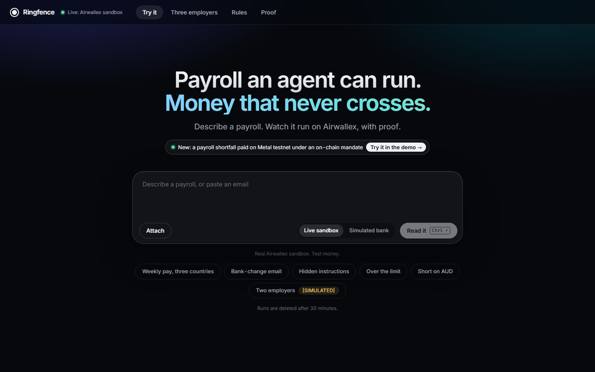

# Ringfence

**A payroll agent that can move every employer's money, but only its own.**
Airwallex Agentic Banking Hackathon, Kit 06 (multi-employer payroll executor).

**Live demo (no login, test money only):** https://ringfence-hs23-eu.indiasouthcentral.cloudapp.azure.com
Demo script: [docs/DEMO.md](docs/DEMO.md)



## The problem

A payroll bureau pays staff for several companies. One wrong transfer pays company A's people with company B's cash.
An AI agent makes that risk bigger, because it reads emails and invoices that anyone can write.

## What Ringfence does

| Rule | How it is enforced |
|---|---|
| Each employer gets its own Airwallex account token | The harness picks the account, never the model. Airwallex itself returns 401 if one employer's token touches another's account. |
| The model proposes, code decides | Amounts, limits, approvals and request_ids come from code (Decimal, never floats). |
| A named person approves | Only that employer's finance approver can release a run, bound to the exact batch. |
| Every call is exactly-once | Deterministic request_ids; a retry or a double click pays once. |
| Everything is provable | Append-only hash-chained ledger, plus a signed certificate built from Airwallex's own records. It verifies offline. |
| Untrusted input stays untrusted | A bank-change email or hidden instruction in a timesheet is quarantined and flagged. Nothing is sent. |

## Try it in two minutes (live link above)

1. **Three employers** tab, press **Run Friday payroll**. Kestrel is inside its mandate. Northwind has rate changes and
   waits for its approver. Harbour is short on AUD and gets its own funding details.
2. Hold to approve Northwind. Then fund Harbour and approve.
3. Press the **Try to break it** cards: a bank-change email, a double click, a network drop, a cross-tenant call, a tampered ledger row.
4. **Proof** tab: isolation is green per employer, certificates download and verify offline.
5. **Try it** tab: type or paste your own payroll and watch it run in a world of its own.


## Metal testnet (optional, on in the live demo)

Harbour's shortfall can be paid on Metal testnet under an on-chain mandate: one pull, a hard cap, one named payee.
The **Pay the shortfall from Metal** card makes a real pull and links the transaction. The **Agent over-pulls on Metal** card asks for more
than the cap, and Metal refuses it on chain (`mandate_cap_exceeded`). Airwallex then gets a `[SIMULATED]` deposit so the
usual matcher closes the funding request. Testnet scale is 1 USDZ = USD 10, because the faucet gives about 100 USDZ.
If Metal is down the card falls back to the simulated top-up. Details: [docs/PLAYGROUND_SPEC.md](docs/PLAYGROUND_SPEC.md) section 9.1.

## Run it yourself

No keys needed for the offline demo (fake Airwallex, scripted agent). Needs [uv](https://docs.astral.sh/uv/).

```
make sync
make fake-demo        # open http://127.0.0.1:8000
make check            # ruff + 359 offline tests, invariants I1-I9 after every scenario
```

Live sandbox: set `AWX_CLIENT_ID`, `AWX_API_KEY`, `AWX_BASE_URL`, `AWX_PLATFORM_ACCOUNT`, `AWX_EMPLOYER_A/B/C` as
environment variables (never commit them), then `uv run python -m ringfence.setup_demo` and `make demo`.
Set `ANTHROPIC_API_KEY` to use Claude (`claude-sonnet-5-5`); without it the scripted agent runs and the demo is unchanged.

## How it fits together

```
lanes (one token per employer) -> gate (pure rules) -> executor (exactly-once) -> Airwallex
                 ledger (hash chain, SQLite) <- every step      verify.py -> Ed25519 certificates
```

| Path | What is there |
|---|---|
| `ringfence/` | gate, executor, ledger, mandates, funding, FX, agent loop, FastAPI app, Metal, MCP server |
| `static/` | the single-page UI |
| `tests/` | offline suite against a fake Airwallex |
| `scripts/` | sandbox probes, live reconciliation checks, e2e demo |
| `deploy/` | Azure VM, Caddy HTTPS, systemd |
| `docs/` | [DEMO.md](docs/DEMO.md), [PLAN.md](docs/PLAN.md), [BUILD_SPEC.md](docs/BUILD_SPEC.md), [PROBES.md](docs/PROBES.md) (what the sandbox really does) |

Also included: a CLI (`uv run python -m ringfence --help`), an MCP server with no approve tool
(`claude mcp add ringfence -- uv run python -m ringfence.mcp_server --backend fake`), plain-English rules the
employer signs, signed webhooks (a hint only; polling stays the truth), and a contractor link that shows one person
their own payment.

## Honest notes

- Fee credits and some deposits are marked `[SIMULATED]` because the Airwallex sandbox cannot do them. Everything else on the live demo is real sandbox calls.
- The live demo is shared and public. Runs reset on request (once per 20 s) and playground runs are deleted after 30 minutes.
- No secrets are in the repo. Deploy steps are in [deploy/](deploy/) and `deploy/metal_vm.sh`.
