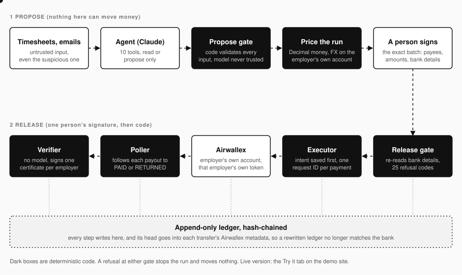
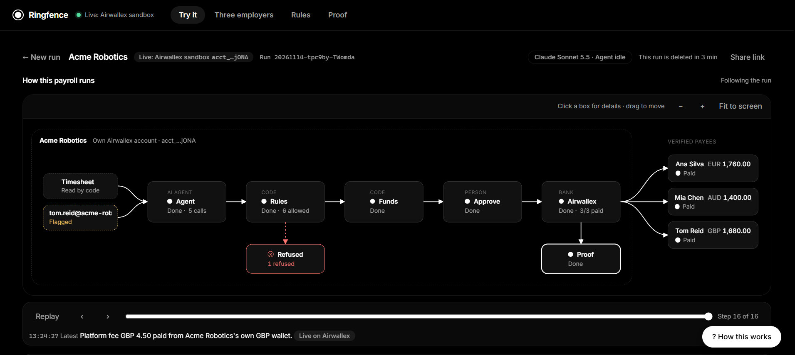
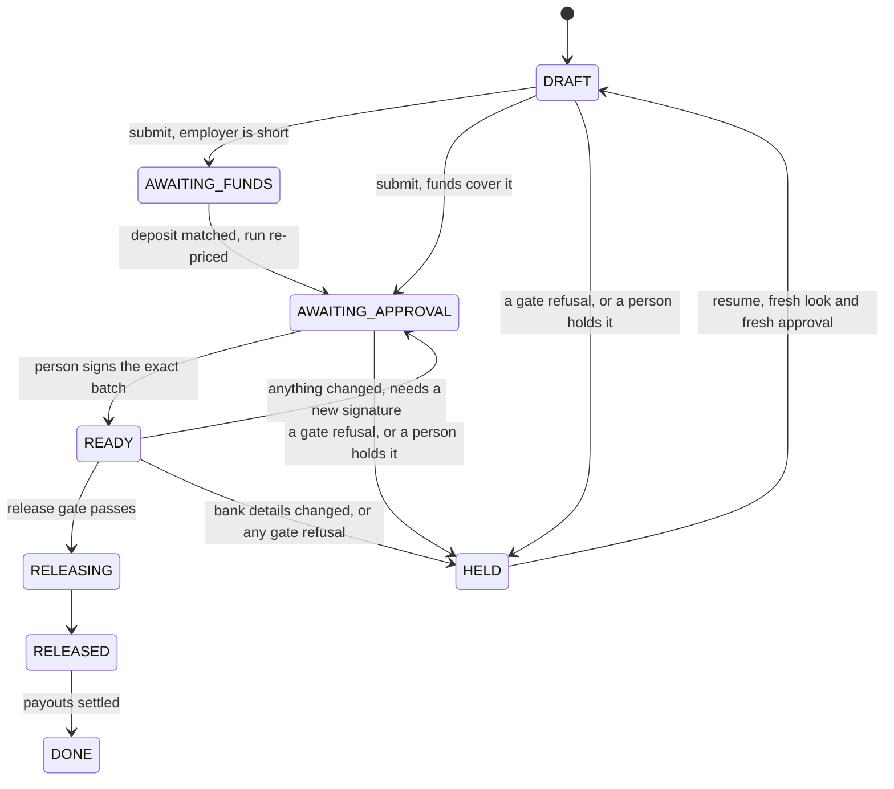

# Architecture

Ringfence sits between an AI agent and Airwallex payouts. The agent can read documents and propose a run. Code checks every proposal, a person signs the exact batch, and code sends it. Payroll is the first use.

The same flow is drawn live, from a real run, in the **Try it** tab of the [demo site](https://ringfence-hs23-eu.indiasouthcentral.cloudapp.azure.com/#/). Start a run there and the flowchart lights up step by step as it happens.

## The rule behind every design choice

The model is never in the path that moves money. It reads files and calls 10 tools that only read or propose. The employer is fixed by the harness before the model starts, so no tool takes an employer or a bank detail from the model. Everything that decides, prices, signs, sends or verifies is deterministic code.

## Components

| Part | Job | Code |
|---|---|---|
| Intake | Parses timesheets with code. The model never sees a number it could change. | [inbox.py](../ringfence/inbox.py) |
| Agent | Reads documents and proposes. Ten tools, none can move money. Offline, a scripted agent calls the same tools. | [agent/](../ringfence/agent/) |
| Gate | A pure function `(action, facts) -> Allow or Deny(code)`. No I/O, clock or model. 25 refusal codes. A missing limit is a refusal. | [gate.py](../ringfence/gate.py) |
| Mandate and approval | An HMAC-signed mandate per employer (payees, currencies, caps, FX band, approver, expiry). An approval signs a SHA-256 of the exact batch. | [mandate.py](../ringfence/mandate.py) |
| Orchestrator | Run lifecycle. The only caller of the executor. | [orchestrator.py](../ringfence/orchestrator.py) |
| Executor | Exactly-once sending: intent saved first, one request ID per payment, lookup instead of resend. | [executor.py](../ringfence/executor.py) |
| Airwallex client | One login per employer, chosen by code. | [awx.py](../ringfence/awx.py) |
| Beneficiaries | Pins bank details at approval, re-reads them before release, quarantines changes. | [beneficiaries.py](../ringfence/beneficiaries.py) |
| FX and funding | FX only on the employer's own balance. A short employer gets exact amount, its own account details and a unique reference. | [fx.py](../ringfence/fx.py), [funding.py](../ringfence/funding.py) |
| Fees | Metered per paid payout, credited back on a return. | [fees.py](../ringfence/fees.py) |
| Ledger | SQLite, append-only, hash-chained. Triggers block `UPDATE` and `DELETE`. | [ledger.py](../ringfence/ledger.py) |
| Webhooks | A signed webhook only prompts a re-fetch. It never sets state. | [webhooks.py](../ringfence/webhooks.py) |
| Verifier | No model. Reads each employer's transfers with its own token, runs 10 checks, signs an Ed25519 certificate. | [verify.py](../ringfence/verify.py) |
| MCP servers | Remote `/mcp` for any agent, and a local stdio one. Neither has an approve tool. | [mcp_remote.py](../ringfence/mcp_remote.py), [mcp_server.py](../ringfence/mcp_server.py) |
| Web app | FastAPI, one money worker thread, the static UI in [static/](../static/). | [app.py](../ringfence/app.py) |
| Playground | Isolated "worlds" for the Try it tab and MCP runs: each world is its own app and state directory. | [playground.py](../ringfence/playground.py) |

## Life of a run

A hold never moves money. Resuming a held run goes back to a draft and needs a new signature.

## Where a run is checked

1. **Propose gate:** the agent's proposal is validated field by field: employer, contractor, currency, amount against the signed mandate.
2. **Pricing:** amounts are `Decimal`, never float. FX is quoted on the employer's own account, inside the mandate's rate band.
3. **Approval:** the approver signs a hash of the run, employer, round and every line including its request ID. It expires after 2 hours.
4. **Release gate:** the same checks again at release, plus funds against this employer's own balance, plus a re-read of every payee from Airwallex. A changed bank account holds the whole run.
5. **Executor:** the transfer carries the approved bank details inline, not an editable payee ID. It is read back after creation and cancelled if it points anywhere else.
6. **Verifier:** after the fact, a separate process with no model re-reads the transfers and signs what it found.

## Trust boundaries

| Input | Trusted? | Why |
|---|---|---|
| Timesheets, emails, invoices | No | Parsed by code. A bank change in an email is quarantined until a second person confirms by phone callback. |
| The model's output | No | Proposals only. Every field is revalidated by the gate. |
| Airwallex API responses | Re-checked | Bank details are re-read before release. A transfer is read back after creation. |
| Webhooks | Hint only | Signature verified, then the transfer is fetched again. |
| The approver's signature | Yes, for one batch | Bound to a hash of the exact run. Any change voids it. |
| The ledger | Tamper-evident | Hash-chained, and its head is written into Airwallex metadata. |

## How the findings are closed

| Finding | Closed by |
|---|---|
| [F1](../FINDINGS.md#f1-approval-swap) Payee account edited after approval | Bank details pinned at approval, re-read at release, sent inline |
| [F2](../FINDINGS.md#f2-bank-change-from-an-email) Bank change from an email | Quarantine and phone callback; the editor cannot approve |
| [F3](../FINDINGS.md#f3-the-node-sdk-shares-one-login) One login shared across employers | One token per employer, chosen by code |
| [F4](../FINDINGS.md#f4-a-retry-pays-twice) A retry pays twice | Request ID fixed before the first try; a timeout means lookup, never resend |
| [F5](../FINDINGS.md#f5-batch-payroll) Batch pays the account at submit | No batches |

## State and storage

| What | Where |
|---|---|
| Ledger and run state | `var/ringfence.db` (SQLite) |
| Contractor and payee registry | `var/registry.json` |
| Signing keys | `RF_MANDATE_KEY` and `RF_APPROVAL_KEY`, or generated once into `var/keys.json` |
| Enrolled passkeys (MCP approval) | `var/passkeys.json` |
| Playground and MCP worlds | one state directory and one local port per world |

`RF_VAR` moves the state directory. A shared database in place of SQLite is a listed [production step](../README.md#limitations-and-path-to-production).

## Mechanisms, with code links

**Approval and bank details**
- The approver signs a SHA-256 hash of the run, employer, round and every line including its request ID. It expires after 2 hours ([mandate.py](../ringfence/mandate.py#L109), [gate.py](../ringfence/gate.py#L167)).
- Bank details are fingerprinted at approval and re-read from Airwallex before release. The run is held if they changed ([beneficiaries.py](../ringfence/beneficiaries.py#L131)). Closes [F1](../FINDINGS.md#f1-approval-swap).
- Each transfer carries the approved bank details inline, not an editable payee ID ([executor.py](../ringfence/executor.py#L206)). It is read back after creation and cancelled if it points anywhere else ([orchestrator.py](../ringfence/orchestrator.py#L187)). Closes [F1](../FINDINGS.md#f1-approval-swap) and [F5](../FINDINGS.md#f5-batch-payroll).
- A bank change from an email is quarantined until an approver confirms it by phone callback. Whoever edited a payee can't approve that payee's payment ([beneficiaries.py](../ringfence/beneficiaries.py#L204)). Closes [F2](../FINDINGS.md#f2-bank-change-from-an-email).

**Exactly once**
- The request ID is `sha256(run, employer, contractor, attempt)`, minted once and stored before the first call. The amount is not part of it ([mandate.py](../ringfence/mandate.py#L115)).
- After a timeout, Ringfence never resends. It looks the payment up by request ID and adopts it only if payee, amount and currency match. Otherwise it holds the line (`DUPLICATE_MISMATCH`) ([executor.py](../ringfence/executor.py#L258)). Closes [F4](../FINDINGS.md#f4-a-retry-pays-twice).
- Before release, it asks Airwallex whether each line was already paid, which catches a lost database ([orchestrator.py](../ringfence/orchestrator.py#L173)).
- A payout that fails after `PAID` becomes `RETURNED`: its fee is credited back and paying again needs a new approval ([executor.py](../ringfence/executor.py#L304)).
- A webhook only prompts a re-fetch of the transfer, after its [signature](https://www.airwallex.com/docs/developer-tools/webhooks/listen-for-webhook-events.md#check-webhook-signatures) is checked ([webhooks.py](../ringfence/webhooks.py#L32)).

**Fund isolation**
- One login per employer: each token is logged in as that account only (`x-login-as`), chosen by code, never by the model ([awx.py](../ringfence/awx.py#L85)). Closes [F3](../FINDINGS.md#f3-the-node-sdk-shares-one-login).
- An HMAC-signed mandate per employer sets allowed contractors, currencies, per-payment and per-run caps, FX rate band, approver and expiry ([mandate.py](../ringfence/mandate.py#L33)).
- The release gate is a pure function (no I/O, clock or model) with 25 refusal codes, such as `TENANT_MISMATCH`, `INSUFFICIENT_OWN_FUNDS`, `BENEFICIARY_IS_OTHER_TENANT_ACCOUNT` and `OVER_RUN_CAP`. A missing cap is a refusal ([gate.py](../ringfence/gate.py#L87)).
- No pooled funds: funds are checked against this employer's balance only, and FX sells only this employer's spare currency ([fx.py](../ringfence/fx.py#L47)).
- **Why separate accounts, not connected accounts.** The sandbox blocks connected-account onboarding ("This account cannot onboard business/individual accounts"), so each employer is its own account in one organisation, reached by one scoped key. Isolation is the same (own balances, payees and global accounts; cross-account calls refused). The risk is also the same, since one key reaches every employer, so isolation rests on code. Switching to connected accounts changes only [`TenantClient._login`](../ringfence/awx.py#L85): log in as the platform and add `x-on-behalf-of`. The login page documents [`x-login-as`](https://www.airwallex.com/docs/api/authentication/api_access_token/login.md) for keys linked to several accounts.

**Deadline-aware funding**
- Act-by time is the currency's bank cut-off on pay day minus 2 hours, shown in the employer's timezone (AUD 11:00 Sydney, GBP 12:00 London, EUR 12:00 Berlin, USD 15:00 New York) ([funding.py](../ringfence/funding.py#L29)).
- A short employer gets the exact amount, its own global account details and a unique reference `RF-<EMP>-<run>-<rand>` ([funding.py](../ringfence/funding.py#L42)).
- A deposit counts only if the reference, global account, currency and status all match. Several deposits add up, the run re-prices and resumes by itself, and a reversed deposit reopens the request ([funding.py](../ringfence/funding.py#L69)). `ACCEPT_PENDING` decides whether pending deposits count ([funding.py](../ringfence/funding.py#L25)).
- `OVERDUE` and `IN_APPROVAL` transfers are tracked to completion and count as not yet debited ([executor.py](../ringfence/executor.py#L167)).

**Proof and audit**
- The ledger is append-only and hash-chained (triggers block `UPDATE` and `DELETE`), and its head (`rf_seq`, `rf_hash`) goes into each transfer's Airwallex metadata, so a rewritten ledger no longer matches Airwallex ([ledger.py](../ringfence/ledger.py#L45), [executor.py](../ringfence/executor.py#L206)).
- A separate verifier with no LLM reads each employer's transfers with its own token and runs 10 checks, including a live cross-employer `401` probe ([verify.py](../ringfence/verify.py#L108)). It issues one Ed25519 certificate per employer, verifiable offline ([verify.py](../ringfence/verify.py#L63)).

**Agent and integrations**
- Claude Sonnet 5.5 runs the agent and Claude Haiku 5.5 reads the files an MCP agent sends (`RF_MODEL`, `RF_DRAFT_MODEL`).
- The agent's 10 tools only read or propose. The employer is fixed by the harness, and every input is validated, then checked by the gate ([agent/tools.py](../ringfence/agent/tools.py#L79)).
- Two MCP servers, and neither has an approve tool, so a person always signs. The [remote one](MCP.md) (`/mcp`, any agent, passkey approval) offers `run_payroll`, `release_payroll`, `payroll_status` and `payroll_proof` ([mcp_remote.py](../ringfence/mcp_remote.py)). The local one offers `get_status`, `price_run`, `propose_run`, `request_release` and `certificate` ([mcp_server.py](../ringfence/mcp_server.py)).

## Runtime shape

One FastAPI process serves the UI, the read-only API ([API.md](API.md)), the MCP endpoint and the approval pages. One worker thread performs all money operations, so there is no concurrent release. Playground and MCP worlds run as separate local apps, and the public process reaches them only over localhost through a whitelisted proxy. The Azure VM files are in [deploy/](../deploy/).

Read next: [MCP.md](MCP.md) for connecting an agent, [AIRWALLEX.md](AIRWALLEX.md) for what Ringfence calls and why.
