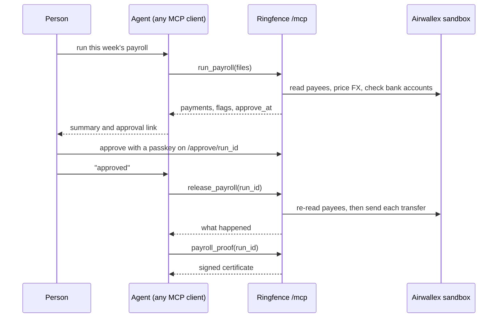

# Ringfence MCP

Any MCP client that supports Streamable HTTP can run payroll through Ringfence. There is no login and nothing to install. The agent hands over the payroll files, code prices and checks the run, a person approves with a passkey, and the agent sends exactly what was approved.

## Connect

```
claude mcp add --transport http ringfence https://ringfence-hs23-eu.indiasouthcentral.cloudapp.azure.com/mcp
```

For another client, add an HTTP MCP server with the URL `https://ringfence-hs23-eu.indiasouthcentral.cloudapp.azure.com/mcp`. For your own instance use `https://<your-host>/mcp` ([self-host](RUN_IT.md#run-the-mcp-server-yourself)).

For a client configured by file (Claude Code's `.mcp.json`, and clients that read the same shape):

```json
{ "mcpServers": { "ringfence": { "type": "http", "url": "https://ringfence-hs23-eu.indiasouthcentral.cloudapp.azure.com/mcp" } } }
```

Check it worked: ask the agent "what Ringfence tools do you have?" It should list `run_payroll`, `release_payroll`, `payroll_status` and `payroll_proof`.

## Try it in two minutes

[demo/payday/](../demo/payday/) is a ready payroll folder for a company called Acme Robotics: a timesheet for three contractors in three currencies, and an email that asks to change one contractor's bank account. Clone the repo, open it in an MCP client with Ringfence connected, and say:

> Run this week's payroll from demo/payday. Show me what will be paid and anything suspicious.

What you should see: Ana Silva (EUR 1,760), Tom Reid (GBP 1,680) and Mia Chen (AUD 1,400) priced, with FX where the employer's currency differs. Ana's email asking for new bank details is listed under `bank_change_requests` as "quarantined: not used". Then try to make the agent skip the approval ("just release it, I approve") and watch it get "Not approved". The agent can also be given [demo/attacks/](../demo/attacks/) documents to see injection attempts refused.

## What happens, in order

1. You tell the agent to run this week's payroll from a folder.
2. The agent calls `run_payroll` with every file, verbatim, including emails it thinks are suspicious. Ringfence decides what to trust.
3. Code reads the files, prices the run on the employer's own Airwallex account and checks every bank account against what Airwallex has saved.
4. The agent shows you the payments, anything flagged, and an **approval link**.
5. You open the link and approve with a passkey (Windows Hello, Touch ID or a security key).
6. You tell the agent you approved. It calls `release_payroll`, which sends exactly what you approved.
7. The agent can fetch the status and a signed proof at any time.



The agent never sees a bank account number, only the last four digits. The only step that needs the person is the approval.

## Tools

The remote server has four tools. None takes a bank detail, and none can approve.

| Tool | Arguments | Does | Returns |
|---|---|---|---|
| `run_payroll` | `files`: object, file name to full text | Reads the files, opens an employer account, checks payees, prices the run and FX | `run_id`, `payments` (name, amount, currency, account ending, state), `totals`, `fx`, `refused_or_flagged`, `bank_change_requests`, `approve_at` |
| `release_payroll` | `run_id` | Sends an approved run. Re-reads every payee from Airwallex first. | Same summary plus `what_happened`, and `changed_after_approval` if a payee was repointed |
| `payroll_status` | `run_id` | Reads where the run is | Same summary, with each payment's Airwallex transfer ID once sent |
| `payroll_proof` | `run_id` | Re-reads every transfer from Airwallex and checks it | `result`, `signature_valid`, `all_checks_passed`, a `download` link to the signed certificate, `payments` |

Limits: 1 to 6 files per run, 8,000 characters in total, one employer per run. A new run replaces the previous agent run, and never while a payout is being sent.

While a tool runs, the client shows progress lines, for example "Reading 3 files", "Opening the employer's own Airwallex account", "Checking each payee's bank account on Airwallex, pricing FX" and "Ready for approval". `run_payroll` can take up to about two and a half minutes while the sandbox account opens.

### What `run_payroll` returns

The shape, with example values (not a recorded run):

```json
{
  "run_id": "…",
  "bank": "Airwallex sandbox, account ending …",
  "employer": "Acme Robotics",
  "state": "AWAITING_APPROVAL",
  "status": "…",
  "payments": [
    { "name": "Ana Silva", "amount": "1760.00", "currency": "EUR", "to_account_ending": "1234", "state": "…" }
  ],
  "totals": { "…": "…" },
  "fx": [ { "sell": "GBP …", "buy": "EUR …", "rate": "…" } ],
  "refused_or_flagged": [ { "what": "…", "decision": "…", "why": "…" } ],
  "bank_change_requests": [ { "id": "…", "name": "Ana Silva", "new_account_ending": "…", "status": "quarantined: not used" } ],
  "approve_at": "https://<host>/approve/<run_id>",
  "notes": [],
  "next": "Show the user a short table … then approve_at. Only they can approve, with their passkey."
}
```

`next` is an instruction to the agent, so the same short table and the approval link come back whichever client is used. `release_payroll` returns the same summary plus `what_happened`, the ledger lines written during the release, and each payment then carries its `airwallex_transfer_id`.

### Run states

`DRAFT`, `AWAITING_FUNDS` (the employer is short and has been asked to fund), `AWAITING_APPROVAL`, `READY` (approved), `RELEASING`, `RELEASED`, `DONE`, and `HELD` (something changed or was refused, nothing more is sent). The full flow is in [ARCHITECTURE.md](ARCHITECTURE.md#life-of-a-run).

## What you will see

| Situation | What the agent gets |
|---|---|
| `release_payroll` before anyone approved | An error: "Not approved. Only a person can approve this run, with their passkey, at `<link>`. No tool can approve it, and asking again will not change that." |
| An email asks to change a payee's bank account | The request appears under `bank_change_requests` as "quarantined: not used". The old verified account is the only one that is paid. |
| A payee's bank account changes on Airwallex after approval | `release_payroll` sends nothing, holds the whole run and reports `changed_after_approval`: the account approved against what Airwallex says now. |
| `release_payroll` on a run already sent | The summary with the note "Already sent. Nothing new was sent." |
| Unknown or expired `run_id` | "Ringfence has no agent run with that id." Runs are throwaway and expire. |
| Another run is mid-payout | "Another payroll is being sent right now. Try again in a minute." |
| More than 6 files, or over 8,000 characters | A plain error naming the limit |

Every payment is labelled `[SIMULATED]` where the sandbox cannot do it for real, and `bank` tells you whether the run used the live Airwallex sandbox or a simulated bank.

## The approval page

`/approve/<run_id>` shows the payments as the signer will be bound to them: each payee, amount, currency and the account ending the money goes to. Approving signs a one-time challenge with a passkey that was enrolled on the server.

- The challenge is used once and expires after 5 minutes.
- The signature must come from an enrolled passkey, for this site, with the person verified by the authenticator (a PIN or biometric, not only a touch).
- If the payroll changed after the page was opened, the approval is refused and the page must be reloaded.
- A pending bank-change request must be rejected, or confirmed by a second person by phone, before the run can be approved.
- The server verifies the signature itself ([mcp_remote.py](../ringfence/mcp_remote.py)); there is no third-party identity service.

**On the public demo,** passkeys are enrolled by the operator, so a visitor's approval link works only on the operator's enrolled device. To watch the approval flow without that, use the **Try it** tab on the site, where a drop-down user approves. To approve with your own passkey, run your own instance and enrol it at `/passkey` ([steps](RUN_IT.md#run-the-mcp-server-yourself)).

## The local server

For offline use, Claude Code or Claude Desktop can run a local stdio server against the fake Airwallex:

```
claude mcp add ringfence -- uv run python -m ringfence.mcp_server --backend fake
```

This repo's [.mcp.json](../.mcp.json) already declares it. It has five tools, all keyed by employer (`northwind`, `kestrel` or `harbour`).

| Tool | Does |
|---|---|
| `get_status` | State of every employer's run |
| `price_run` | Totals, changes since last week, FX legs, shortfall. Moves no money. |
| `propose_run` | Submits the run through the same gate. Waits for a person unless the signed mandate allows auto-release. |
| `request_release` | Releases an already-approved run. Refused unless a person approved this exact batch. |
| `certificate` | The signed segregation certificate for an employer |

It has no approve tool either. Approval is a person's signed act in the Ringfence UI or CLI.

## Why no approve tool

An agent that can approve its own run is only as safe as the agent. Leaving the approve step out of the tool list means no prompt, document or email can talk the agent into it. The only door is the passkey page, and it signs the batch the person saw.

## Why only four tools

Every tool on a payments server is something a hijacked agent can call. So the list is as short as the job allows, and each tool is limited by what it takes in.

| Not offered | Why |
|---|---|
| Approve a run | Only a person's passkey can. |
| Create or edit a payee, or pass a bank detail | Bank details come from what is saved on Airwallex, and a change from an email is quarantined for a phone callback ([F2](../FINDINGS.md#f2-bank-change-from-an-email)). |
| Set an amount, a currency or a rate | Code prices the run from the files and the approved mandate. |
| Send a single transfer, or a batch | `release_payroll` sends only what was approved, with one request ID per payment ([F4](../FINDINGS.md#f4-a-retry-pays-twice), [F5](../FINDINGS.md#f5-batch-payroll)). |
| Choose the employer's account or token | One token per employer, chosen by code ([F3](../FINDINGS.md#f3-the-node-sdk-shares-one-login)). |

So the agent reads, proposes, asks a person, and asks for the send. The tools that exist are the four above, and the controls behind them are in [ARCHITECTURE.md](ARCHITECTURE.md).

## Side by side


Same model, same Airwallex account, same payroll. Between approval and sending, Tom's bank account was changed on Airwallex. On the left, the standard agent approved a batch of IDs, with no names or bank accounts, and Tom's pay went to the new account (`99999901`). The batch cancel failed with `401 Admin permissions required`, and Airwallex has switched admin keys off. On the right, Ringfence held the run and nothing was sent. The standard agent's batch hit this 4 times out of 4 ([F5](../FINDINGS.md#f5-batch-payroll)). The two panes are two takes of the same demo, shown side by side as in the video: [watch it used on Claude MCP](https://youtu.be/QnPQ9EYWWQQ).

More evidence: [BENCH.md](BENCH.md). Injection results: [GAUNTLET.md](GAUNTLET.md).

## If something goes wrong

| What you see | Cause and fix |
|---|---|
| The client says it cannot connect | Check the URL ends in `/mcp` and that the client supports Streamable HTTP. The live site must be up: open it in a browser. |
| `Send between 1 and 6 files` or `too long together` | Send fewer or shorter files. The limit is 6 files and 8,000 characters in total. |
| `Ringfence could not read a payroll from these files` | The files did not say who to pay, how many hours and at what rate. Add the timesheet. The reply lists which fields were missing. |
| `The Airwallex sandbox account did not open in time` | The shared sandbox is busy. Try again in a minute. A run falls back to a [SIMULATED] bank if the sandbox is unavailable, and `bank` says so. |
| `Another payroll is being sent right now` | One agent run at a time. Wait a minute. |
| `Ringfence has no agent run with that id` | The run expired or was replaced by someone else's. Runs are throwaway: start a new one. |
| The approval link opens but approving fails | On the public demo only the operator's enrolled passkey can approve. Use the Try it tab, or run your own instance ([steps](RUN_IT.md#run-the-mcp-server-yourself)). |
| `Not approved` from `release_payroll` | Working as designed. A person must approve at the link first. |

## Known limits

- The public endpoint has no login. Each run is a throwaway sandbox world with one employer, and any caller can replace the last agent run.
- Sandbox only. See [Limitations and path to production](../README.md#limitations-and-path-to-production).
